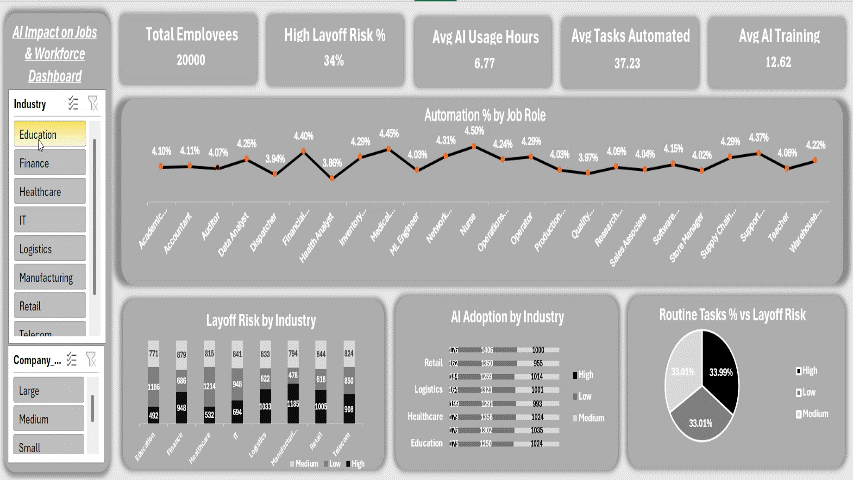

# AI Impact on Jobs & Workforce Dashboard – Excel

## Project Overview
An interactive Excel dashboard analyzing the impact of Artificial Intelligence on jobs and the workforce across different industries.

## Dashboard Preview

## Key Analysis
- AI Adoption & Usage Trends
- Job Roles & Layoff Risk Analysis
- Tasks Automation Percentage
- AI Training & Experience Analysis
- Impact of AI on Creativity and Human Interaction

## Tools & Skills
- Microsoft Excel
- Data Cleaning & Analysis
- Pivot Tables & Pivot Charts
- Interactive Dashboard
- Data Visualization
- KPI Analysis

## Objective
To identify workforce trends, understand AI-driven job automation, and gain insights into the changing job market.

** Author**
Shweta A Walishettar
Aspiring Data Analyst | Power BI | Advanced Excel | SQL | Power Query
